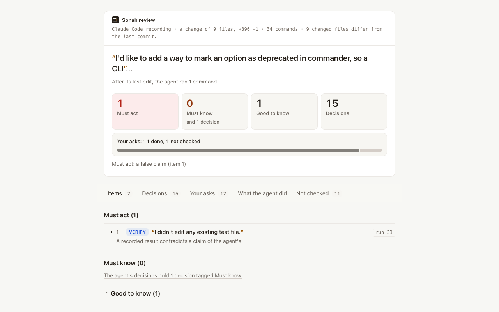

<div align="center">

# Sonah

**Reviews what your coding agent did, not just the diff: did it do what you asked, what it decided on its own, and what
is wrong in the code.**

[](https://github.com/getsonah/sonah/actions/workflows/ci.yml)

[Website](https://sonah.dev) &nbsp;&bull;&nbsp; [Install](#install) &nbsp;&bull;&nbsp; [Cost and time](#cost-and-time) &nbsp;&bull;&nbsp; [Privacy](docs/PRIVACY.md) &nbsp;&bull;&nbsp; [Guide](docs/INSTALL.md) &nbsp;&bull;&nbsp; [Changelog](CHANGELOG.md)

<picture>
  <source media="(prefers-color-scheme: dark)" srcset="https://raw.githubusercontent.com/getsonah/sonah/assets/review-dark.png">
  
</picture>

</div>

## What you get

- **Did it do what you asked?** Each ask in your prompt, marked done, partly done, not done or not checked. A row that
  is not checked also says when the code review found that the ask holds in the code, which Sonah did not check.
- **What did it decide, and is "done" true?** The decisions it took alone, for you to confirm or overrule. The claims
  its own recorded results contradict, such as "all tests pass" after a failed test.
- **What is wrong in the code?** With the default reviewer, a code review agent reads your repository with read-only
  tools. It checks the change against your asks and the agent's claims.

You hand the work to Claude Code or Codex. It says "done, all tests pass", and a pull request lands. The diff cannot
tell you what you asked, whether "done" is true, or what the agent decided alone. Sonah runs on your machine, through
your own login, and reads the agent's session before you merge. [What is sent where](#what-is-sent-where) says what
leaves your computer.

Each item goes in Must act, Must know or Good to know. It says what it is and where it is. Every quote is word for word
from the session or the code, and code checks each quote. There is no score and no verdict: you make the call.

## Install

```sh
npm install -g getsonah
sonah doctor                  # checks Node, your claude login and one tiny model request
cd ~/code/your-project
sonah review --format html --output ~/review.html     # reviews the newest session here, opens the page, writes ~/review.md
sonah                                                 # draws your branch's change as a page of graphs and opens it
```

In a terminal, plain `sonah`, with no command, runs `sonah visual` through your own `claude` login and opens its page
in your browser. `sonah --help` lists every command.

To try it without installing, run `npx getsonah doctor`. To install from a checkout instead:

```sh
git clone https://github.com/getsonah/sonah sonah && cd sonah && node scripts/install.mjs
```

To update, run `npm install -g getsonah@latest`. [Update](docs/INSTALL.md#update) gives the other ways. To remove
Sonah, first run `sonah hook remove` in each repository where you ran `sonah hook add`, and `sonah skill remove` if you
added /sonah; then run `npm uninstall -g getsonah`.

## Requirements

- Node.js 20 or newer, and Git. macOS or Linux. Windows is not verified.
- Claude Code, signed in (`claude auth login`), with an account that can use `claude-sonnet-5-5[1m]`. Sonah reviews
  through this login. Your Codex login or an Anthropic API key also work, for the session review alone.
- The sessions: Sonah finds Claude Code and Codex sessions in the project where you run it. Cursor is experimental:
  give the path of its recording.
- The code review runs only with the default reviewer, your `claude` login. With `--backend codex-cli` or
  `--backend anthropic-api`, Sonah reviews the session alone.

## Cost and time

Sonah makes its calls through your own `claude` login. A review counts toward your Claude plan's usage limits, as your
own Claude Code work does. If your login bills an API account instead, it bills that account. Before the first call,
Sonah prints roughly how long the review should take. At the end, it prints the calls, the tokens, and how much of your
plan's usage limits is now used.

Three reviews, made with 0.3.0 beta builds from before this release, as their usage lines printed them:

| Session | Recording | Calls | Input tokens | Time |
| --- | --- | --- | --- | --- |
| Short | 0.3 MB | 12 | 0.24M | 2 minutes |
| Short | 0.2 MB | 8 | 0.44M | 4 minutes |
| Long, with helper agents | 3.1 MB, with 34 helper recordings (14 MB) | 116, and 12 for the code review | 28.7M, and 6.4M for the code review | 20 minutes, and 6 for the code review |

The two short reviews include the code review. In the long session, the session review stopped at a usage limit set
with `--stop-at-utilization`, and the same command resumed it. The code review ran on its own, with a later build.
Your numbers will differ with the length of the session and how much the agent did.

## Usage

Go into the project where you ran the agent, then review its newest session:

```sh
cd ~/code/your-project
sonah review --dry-run                                # what would be reviewed and roughly how long, with no model call
sonah review --format html --output ~/review.html     # review it, open the page, and write ~/review.md
gh pr comment --body-file ~/review.md                 # post the .md on your branch's pull request yourself
```

The page and the .md hold the same report. The .md is for a pull request comment. Sonah prints the `gh` command and
posts nothing itself. `~/` is your home folder, outside the project, so the next review does not read the report as
part of the change. A path inside the project works when `.gitignore` holds it.

When the session's work is committed, the review also draws the graphs page of the session's commits first, as
`sonah visual` does, with `claude -p` on your Claude plan (with `--code-base`, of the whole branch since that base). It
prints `Graphs page: <path>` and the calls and cost it took, and the review page links to it. The .md never does.
`--no-visual` skips it. It is not drawn on another backend than `claude-cli`, under `--max-calls`, `--max-input-bytes`
or `--stop-at-utilization`, with the code review off, or while the change is not all committed. One line then says why,
and the review page says it where the link would be, as it says the problem and fix of a graphs page that fails; where
`sonah visual` can draw it, the line names that command. Ctrl-C while it is drawn stops the graphs page only: the
review still writes its page.

After you commit and push your work, the report links each place in the code to GitHub. Did you run Sonah before you
committed? Then commit, push, and run the same command with a new `--output` file. Sonah reuses its stored answers, so
the second run makes no model call for the review; an HTML review whose work is now committed draws its graphs page,
with calls of its own.

Other ways to run it:

```sh
sonah sessions                                        # this project's recorded sessions, newest first
sonah review --choose 2 --format html --output ~/second.html
sonah review /path/to/session.jsonl --format html --output ~/review.html
sonah review --format md --output ~/review.md         # the Markdown report only, no page
sonah review --no-visual --format html --output ~/review.html   # the page, without the graphs page of the commits
sonah review --no-code-pass --format html --output ~/session.html   # the session only, no files read
sonah review --code-base main --format html --output ~/branch.html  # the code review reads all the branch changed since main, in this folder
sonah review --backend codex-cli --model gpt-6.1-sol --format html --output ~/review.html   # your codex login, the session only
sonah skill add                                       # once; then type /sonah in Claude Code to review that session
sonah hook add                                        # once per repository: Claude Code's commits name their session
sonah sessions --commits main..HEAD                   # the sessions behind your branch, after sonah hook add
sonah visual                                          # a page of your branch's change, with How and Where graphs
sonah visual main..HEAD                               # the same, for a range you name
sonah                                                 # in a terminal: sonah visual, and it opens the page
```

A review that stops partway resumes when you run the same command again. [Troubleshooting](docs/TROUBLESHOOTING.md)
lists the messages and exit codes.

## What is sent where

- **To the reviewer model, through your own login:** the session as the recording holds it. [Privacy](docs/PRIVACY.md)
  lists the few parts that are cut or left out, such as the agent's private reasoning. By default this is your
  `claude` login, so it goes to Anthropic. With `--backend codex-cli` it goes to OpenAI through your `codex` login.
  With `--backend anthropic-api` it goes to Anthropic's API with your key.
- **With the code review (on by default):** files of your working directory and of the git repositories that the code
  review reads ([Privacy](docs/PRIVACY.md) says which): the session's change, the other files that differ from where
  the session started, the lines the session read of other files and the skill files it used, as they are now, and
  what the code review's read-only agents open. Turn the code review off with `--no-code-pass`, or for every review
  with `sonah config code-pass off`.
- **With `sonah visual`, plain `sonah` in a terminal, or `sonah review --format html` on committed work:** the change of
  the range (for the review, from where the session started to `HEAD`; with `--code-base`, the whole branch since it
  met that base), through your own `claude` login: the repository's name, the commits' messages, the changed files'
  paths and each changed function's code with its added and removed lines. It reads no recording. The review skips it
  with `--no-visual`.
- **When you press "Save online" or "Invite your team" on that page:** your browser sends that review to Sonah's
  hosted team version, https://pr.sonah.dev (or the server that `sonah visual --server` names): the change's code and
  diff as the review holds them, the commits' ids and messages, the findings, the paths and names of functions
  elsewhere in the repository that call the changed ones, the repository's owner and name and the branch
  ([Privacy](docs/PRIVACY.md#save-online-and-invite-your-team) lists it all). You sign in there and it is saved to
  your account. Nothing is sent until you press one, and the buttons are there only when the push remote of the
  repository names its owner and name.
- **Nothing else about you or your work leaves your computer.** Sonah sends nothing to us on its own: no telemetry, no
  analytics. Once a day at most, with a review's first call to the reviewer and in `sonah doctor`, it asks npm's
  public registry for getsonah's latest version (one GET of `https://registry.npmjs.org/-/package/getsonah/dist-tags`)
  and tells you when a newer Sonah is out. That request holds no session text, path, setting or id: npm sees the
  request itself, from your IP address, as for any package download. Sonah never installs anything. Turn the check off
  with `sonah config update-check off` or `SONAH_NO_UPDATE_CHECK=1`; it is off when `CI` is set. Sonah asks GitHub
  only about a pull request you name with `--github`, and posts nothing to GitHub unless you ask and confirm.
- **Sonah masks nothing.** The page and the .md show the session as the recording holds it, secrets included. Read the
  report before you share it.

If the reviewer's provider did not run the agent, the session goes to that provider for the first time.
[Privacy](docs/PRIVACY.md) says exactly what each request holds and what Sonah keeps under `~/.sonah`.

## Docs

- [Install and usage guide](docs/INSTALL.md), with the [known limits](docs/INSTALL.md#known-limits) of this beta
- [Privacy](docs/PRIVACY.md)
- [Troubleshooting and exit codes](docs/TROUBLESHOOTING.md)
- [Contributing](CONTRIBUTING.md) &nbsp;&bull;&nbsp; [Security](SECURITY.md)

## License

Sonah is open source under the [MIT License](LICENSE). Anyone can use it free of charge for any purpose, at work, in a
team of any size or in CI, and copy, change and share it, as long as copies keep its copyright and licence notice.

[LICENSE](LICENSE) has the exact terms. Third-party notices are in [THIRD_PARTY_NOTICES.md](THIRD_PARTY_NOTICES.md).
